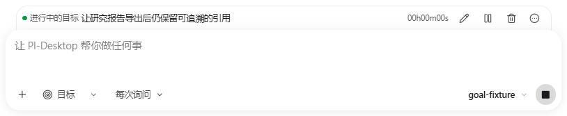
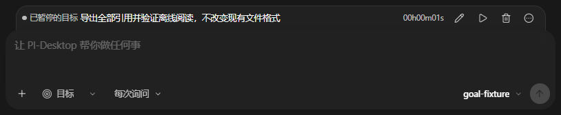

# Goal integration with current main

The published Goal branch now contains upstream main **`4eea56e7f6caa9e7212b18de4988275a6e0f90aa`** through merge
commit **`b9bde9372d37987ba35e72a88f294679f8f96669`**. This is integration into the task branch, **not** a merge
into upstream/local main or a release. The original published task commit remains
an ancestor; history was not rewritten. Related feature request: [#1995](https://github.com/vastsa/PI-Desktop/issues/1995).

## Outcome and impact

66 incoming commits (not the earlier count of 64) affected 127 files; 24 overlapped
the Goal candidate. Only the ADR index and unreleased notes had text conflicts.
Both sides were retained. No product-source conflict needed hand resolution.

| Interaction inspected | Finding and evidence |
| --- | --- |
| Provider retry/idle, cached context usage, thinking and Gemini function-call signatures | Goal authority/settlement hooks coexist with upstream changes. Full runtime source suite: 1,682 pass / 1 skip, including the new replay/retry/Stop/context/compaction regressions. Goal's reported usage settlement remains distinct from context-occupancy estimation. |
| Stop and checkpoint settlement | Full host-runtime suite: 168 pass / 3 skips. Real checkpoint process/disk probe passes held-write shutdown/restart and per-session serialization. Goal edit/delete/late settlement process flow also passes. |
| Composer IME and retained input history | IME composing flag is forwarded alongside the Goal wrapper. Desktop incoming/Goal suite: 266 pass. One old source-contract regex was updated to the public submitUserPrompt entry while preserving accepted-session history behavior. |
| Settings radial menu relocation | The upstream radial menu is in General; the Goal budget remains in AI. Actual settings save/reopen and dark/light/wide/narrow geometry pass. |
| Host storage and review state | Upstream schema remains v27, with no collision against Goal v28-v30. Provider replay is additive transcript metadata; append-only review state is not a Goal storage replacement. Relevant Rust suite: 214 pass. Real review-state persistence probe appends 129 bytes to an approximately 16 MiB transcript and passes restart. |
| Permissions and old tests | Corrected old schema-version pins and visualization's obsolete Plan-like Goal expectation. Added explicit remote-Goal denial assertion; no product permission boundary was weakened. |

No concrete Goal regression was found within the tested paths. This is not a claim
that every repository/platform behavior was proved correct. Incoming-only source
files are unchanged except the explicit input-history test adaptation. The only
non-test script change accepts a validated Goal artifact directory name so these
fresh screenshots do not overwrite previous evidence.

## Verification actually performed

| Check | Result |
| --- | --- |
| Shared full source tests | 670 pass |
| Agent runtime full source tests | 1,682 pass / 1 skip |
| AgentHost full source tests | 93 pass |
| Host runtime full source tests | 168 pass / 3 skips |
| RACP full source tests | 28 pass |
| Desktop incoming + Goal + Composer/Plan/compiler regressions | 266 pass |
| Total JS/TS | **2,907 pass / 4 skips** |
| Rust relevant Goal/database/settings/config/Plan/permission/queue/visualization/review suites | **214 pass / 0 fail**; overlaps the full run, not added to it |
| Rust full repository | **1,114 pass / 19 fail / 1 ignored**; details below |
| Six JS package builds; Desktop/pi-host typechecks; Electron production build; Rust host build | Pass |
| Style-token, architecture, rustfmt, related Biome, diff check | Pass |
| Clippy all targets | Completed; 3 existing warnings retained |
| Eight Goal process scenarios | All pass; completion, turn-budget, token-budget, finite-both, unlimited, audit-recovery, settings-default, pause |
| Goal owner controls/edit/remove/restart/late report/history process flow | Pass |
| New upstream checkpoint and append-only review-state process flows | Pass |
| Actual built Desktop, 61 pages/crops | Pass; 4 explicit loopback requests |
| Isolated boot / 800-session responsiveness / sandboxed preload / Ctrl-R blocking | Pass |
| Main ancestry gate | Passed for the tested upstream revision; remote API confirmed it still matched before publication preparation |

Unlimited completes after 21 Goal turns / 22 model requests in the fixture; audit
recovery deliberately receives one malformed completion refusal then stores the
corrected audit. Those are controlled fixture results, not real-provider success.
All process and UI E2E ran from merge commit `b9bde9372d37987ba35e72a88f294679f8f96669`. Subsequent report/image
commits do not change its executable tree.

### Full Rust failures: not reported green

Six failures (Windows background child termination; three data-relocation path or
capability-key cases; two remote-read permission expectations) reproduce on exact
upstream main in the same environment. Thirteen remaining failures have the Windows
Git CRLF-vs-LF class; an upstream worktree case and an upstream RPC case reproduce
that class. Their production/test source is otherwise unchanged from upstream.
Only eight representative failing tests were rerun on the upstream snapshot, not
all nineteen. Full failure names are in [results.json](results.json).

An attempted environment-only autocrlf override is stripped by the worktree Git
security wrapper; that isolation was not weakened. A second exploratory full run
under the override had two extra worktree failures; it is not the authoritative
final result above.

Baseline and candidate initially shared a same-named Cargo test executable; the
first 170-test relevant run was rejected as candidate evidence. Only the task-owned
host-core outputs were cleaned and rebuilt. The final executable was checked to
list 1,134 tests including 46 Goal tests and the updated visualization contract
before rerunning the final full/relevant suites. Dependencies were reused without
installing a second environment. Initial baseline compilation attempts missing
shared fixture/Cargo configuration were corrected; failed attempts were not counted
as passes. Local raw logs remain local, not part of this public report.

## Fresh actual UI photographs

Real built Windows Desktop, isolated profile/Rust state, loopback-only model and
synthetic objective/audit data. No daily-app attachment, credentials or paid model.
These photographs are fresh after main integration; older galleries remain intact.

| Running, light | Paused, dark |
| --- | --- |
|  |  |

- Full pages: [running](05-running-dark.png), [paused](32-paused-dark.png).
- Dark running: [composer](06-running-closeup.png); light paused: [composer](36-paused-light-closeup.png).
- Joins: [left dark](31-running-dark-left.png), [right light](34-running-light-right.png).
- Narrow running: [dark](40-running-narrow-dark-composer.png), [light](40-running-narrow-light-composer.png).
- [Hint-free normalized budget](28-budget-invalid-unlimited.png), [details](10-details.png),
  [single-close removal](11-delete-confirm.png), [retained TaskDock](12-deleted-tasks-restored.png).

Measured 14px side insets, intact 20px input top radius, no overlap/overflow and
compact budget geometry continue to pass. Opening details does not change dock
height; pausing freezes host-backed elapsed time. All 556 pre-existing artifact
hashes were checked unchanged. [Results and build identity](results.json).

## Remaining gates

No merge conflict or Goal-specific targeted-test blocker remains. **Full Rust is
not green**, and the baseline failures are explicitly out of scope. This is not
Linux/macOS, paid-provider, all-repository or release acceptance. Existing bundle
size and Clippy warnings remain. No dependency installation, version bump, release
packaging, daily-app installation, force-push or modification of local main.

Upstream's external feature-PR restriction remains in force; Issue #1995 has no
maintainer acceptance reply at the latest check. Updating the fork does not assert
that an upstream PR was created or approved. Maintainer policy/review and any final
integration gates remain prerequisites for landing.

## Reproduce

Use existing compatible dependencies and a writable isolated `PI_SCRATCH_DIR`.
Build the candidate Rust host and set `PI_HOST_CORE_BINARY` to its absolute path.
Set a task-owned Cargo target directory if reusing the host environment. No
verify:ui:* or real provider is needed.

```sh
node node_modules/typescript/bin/tsc -p packages/shared/tsconfig.json
node node_modules/typescript/bin/tsc -p packages/i18n/tsconfig.json
node node_modules/typescript/bin/tsc -p packages/agent-runtime/tsconfig.json
node node_modules/typescript/bin/tsc -p packages/agent-host/tsconfig.json
node node_modules/typescript/bin/tsc -p packages/host-runtime/tsconfig.json
node node_modules/typescript/bin/tsc -p packages/racp/tsconfig.json
node node_modules/typescript/bin/tsc -p apps/desktop/tsconfig.json --noEmit
node node_modules/typescript/bin/tsc -p apps/pi-host/tsconfig.json --noEmit
(cd packages/agent-runtime && node ../../node_modules/vitest/vitest.mjs run src --no-cache)
(cd packages/host-runtime && node ../../node_modules/vitest/vitest.mjs run src --no-cache)
node --test apps/desktop/test/goal-*.test.mjs apps/desktop/test/composer-input-history.test.mjs apps/desktop/test/composer-ime.test.mjs apps/desktop/test/inflight-checkpoint-lifecycle.test.mjs
cargo test -p host-core --locked --offline -- goals:: rpc::goals_rpc db:: settings:: config_sync:: plans:: permissions:: turn_queue:: plugins::providers::tests::a_new_database rpc::visualization_tests sessions::tests::tool_review_state sessions::tests::truncate_from_folds_review --test-threads=4
cargo fmt --check
cargo clippy -p host-core --all-targets --locked --offline
cargo build -p host-core --locked --offline
(cd apps/desktop && node node_modules/electron-vite/bin/electron-vite.js build)
PI_GOAL_ARTIFACT_NAME=goal-integrated-main PI_DESKTOP_HOST_BIN="$PI_HOST_CORE_BINARY" node scripts/render-goal-pages.mjs
PI_HOST_CORE_BINARY="$PI_HOST_CORE_BINARY" node scripts/e2e-goal-controls.mjs
for scenario in completion turn-budget token-budget finite-both unlimited audit-recovery settings-default pause; do
  GOAL_E2E_SCENARIO="$scenario" PI_HOST_CORE_BINARY="$PI_HOST_CORE_BINARY" node scripts/e2e-autonomous-goal.mjs
done
node scripts/e2e-checkpoint-lifecycle.mjs
PI_DESKTOP_HOST_BIN="$PI_HOST_CORE_BINARY" node scripts/e2e-review-state-persistence.mjs
PI_DESKTOP_HOST_BIN="$PI_HOST_CORE_BINARY" node scripts/e2e-electron-boot.mjs
node scripts/check-style-tokens.mjs
node scripts/check-architecture.mjs
node scripts/check-pr-base-main.mjs
git diff --check
```
