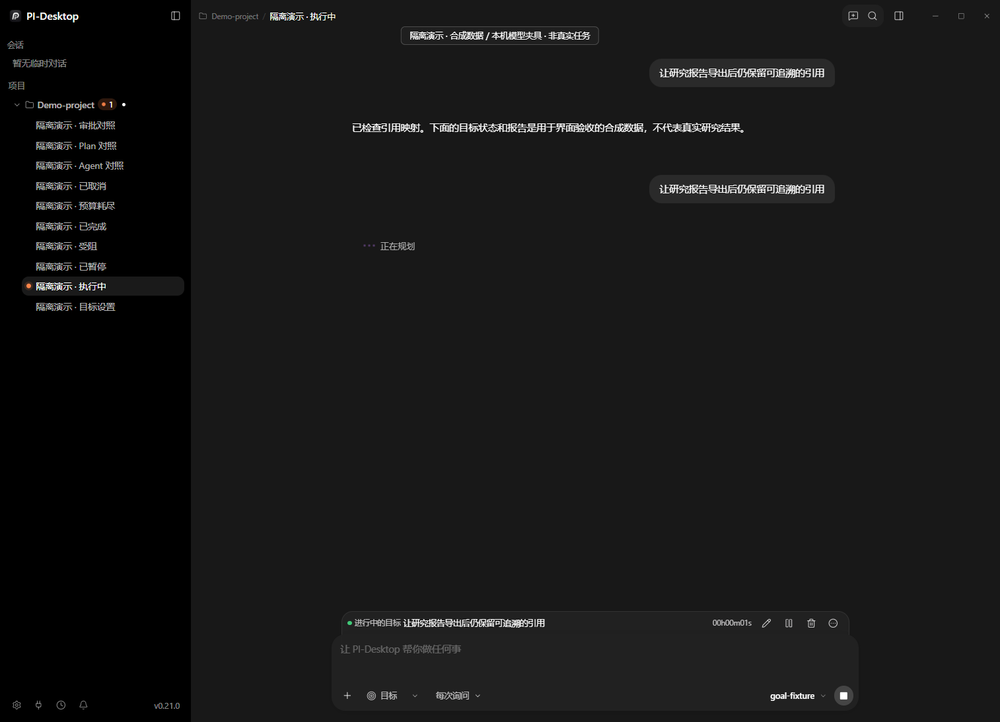
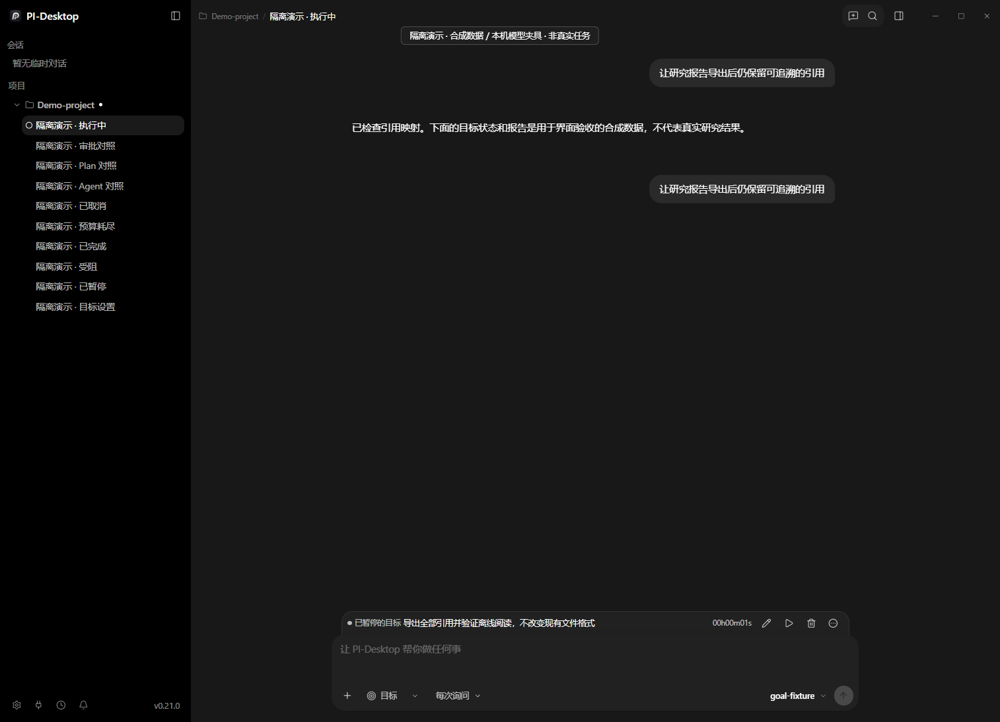
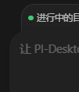
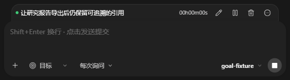
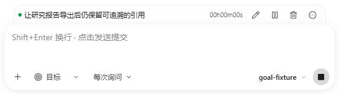
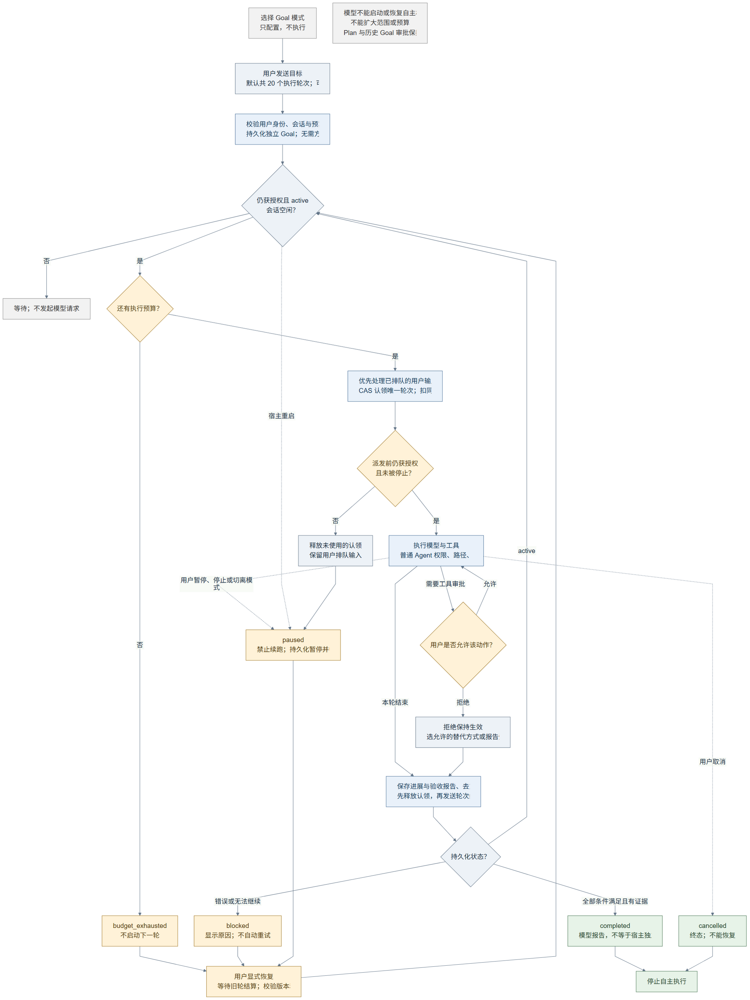

# Autonomous Goal: feature proposal and UI evidence

This is a **feature proposal**, not a ready-to-merge PR. Upstream currently accepts
only external fix/perf PRs; this fork branch and an enhancement issue are shared to
ask whether the maintainers want this direction before a PR is opened.

## Problem and proposed behavior

A Goal should represent the complete user objective across execution turns, not
only a Plan-style approval or a finished response. This candidate introduces a
Rust-owned durable Goal lifecycle with explicit user startup, automatic continuation
under ordinary permissions, user pause/resume/edit/remove controls, budget accounting
and a structured completion audit by the current model.

- Only explicit user send/resume authorizes execution. Selecting Goal, editing
  defaults, opening details or closing a dialog does not start work.
- Defaults: 20 execution turns, unlimited tokens. Budgets are snapshotted for a new
  Goal; changing defaults never widens an existing Goal. Token caps are soft,
  checked between turns, not a mid-response hard billing ceiling.
- Positive whole turns up to 10,000 and positive safe whole token counts are finite
  caps. Other UI inputs normalize per field to Unlimited on blur/Enter, without
  helper/validation/saving/saved text. Host validation remains strict.
- A compact inset header tucks behind the original rounded Composer. Circle-ellipsis
  opens details. A current Goal suppresses TaskDock presentation without deleting
  stored todos; removal restores it and retains chat/task history.
- Edit first pauses and waits for settlement; saving preserves usage/budget/time,
  clears old scope evidence and remains paused. Logical removal retains old claims
  for safe late settlement without resurrecting the removed Goal.
- Completed Goals remain visible with details/removal controls until removed.
- Completion needs an exact-objective structured audit with no remaining work.
  This audit is **model-reported**, not independent host verification of truth.
- Restart pauses unfinished active work without replay. Existing Plan and legacy
  Goal approvals retain their historical behavior and acquire no autonomous authority.

## UI photographs

All images are from an actual built Windows Desktop using an isolated Rust database
and controlled loopback model. Objectives, audits and status fixtures are synthetic;
no paid-provider or research-task success is implied. Elapsed time was not fabricated.
Wide viewport: 1442 CSS px; supported narrow Desktop: 880 CSS px. Component probes
also exercise 960/390/320 CSS px. The browser gallery contains all 62 UI images;
GitHub renders the individual images below without running the HTML.

| Running, light | Paused, dark |
| --- | --- |
|  |  |


| Whole running page | Whole paused page |
| --- | --- |
|  |  |

| Left attachment | Right attachment and details icon |
| --- | --- |
|  |  |

| Narrow, dark | Narrow, light |
| --- | --- |
|  |  |

- [Opened details](10-details.png), [single-close removal](11-delete-confirm.png),
  [retained TaskDock after removal](12-deleted-tasks-restored.png).
- [Zero](03-budget-zero.png), [persisted and reopened Unlimited](26-budget-reopened.png),
  [finite Enter save](27-budget-finite-saved.png),
  [negative turns](28-budget-invalid-unlimited.png), [fraction](42-budget-fraction.png),
  [over-limit turns](43-budget-overflow.png), [malformed input](44-budget-malformed.png),
  [negative Tokens](45-token-negative-unlimited.png), [unsafe Tokens](46-token-unsafe-unlimited.png).
- [Explicit budget/resume form](41-resume-zero.png), [completed Goal](15-completed.png),
  [current-model audit](16-completion-audit.png), [Agent comparison](21-agent-tasks.png),
  [Plan comparison](22-plan.png).
- [Complete gallery HTML source](https://github.com/new-Beginner/PI-Desktop/blob/088c21fe47dc37df46769a6ae02fce6d77937760/docs/artifacts/goal-proposal/index.html), [measured geometry](screenshots.json),
  [historical screenshot source hashes](source-manifest.json).

The header is approximately 14 CSS px narrower on each side; Composer retains its
20px top radius. Measured join gap is floating-point noise (~0.000031 CSS px), with
no input overlap or horizontal overflow. Budget inputs measure 30.9970px against
30.9821px for Default mode (difference ~0.0149px).

## Architecture and compatibility

Renderer -> Preload IPC -> Electron Main -> Rust host core / Node agent runtime.
Rust owns persistence, claims/CAS revisions, settlement and active-time checkpoints.
Runtime derives continuation from trusted Goal context, not fabricated user messages.
Owner admission, tool permissions, sandbox/path/plugin checks remain intact.

The candidate adds backed-up schema migrations through v30 for Goal storage/audit,
logical removal and elapsed checkpoints. Legacy finite budgets remain finite; old
reports gain no invented audits. An old binary opening newer schema is not supported.
Hard-crash uncheckpointed active-time tails may be lost; forward wall-clock changes
can inflate a live interval. This is lifecycle UI time, not billing-grade metering.

The Rollup compiler is pinned to 4.66.0 with its namespace-export regression test:
older versions emitted invalid external namespace bindings from valid SDK imports.
No generated output is patched and no release version is advanced for this proposal.

## Verification and reproducible commands

The screenshot candidate is based on `68868dfc8f7d040481ba2432c2178399386d2a9d`.
It is **not rebased/integrated with current main**. The original base is deliberately
preserved for this fork-only proposal; main integration and candidate/PR gates must
be rerun if the maintainers accept the feature. The publication-time checks are
recorded separately in [verification.md](verification.md).

The last UI iteration had 71/71 targeted tests, Desktop typecheck, production
Electron/i18n build, style/architecture/diff checks and 11-file related lint passing.
Its actual Desktop flow captured 61 pages/crops with four explicit loopback requests;
real Host/runtime controls also passed (2 requests, 1 user row, deletion/restart/late
report/history fences). These are base-specific results, not latest-main acceptance.

Use the existing compatible host environment, with no install solely for UI tests:

```sh
node --test apps/desktop/test/goal-*.test.mjs apps/desktop/test/composer-mode-menu.test.mjs apps/desktop/test/composer-permission-mode.test.mjs apps/desktop/test/composer-send-state.test.mjs apps/desktop/test/plan-mode-source-contract.test.mjs apps/desktop/test/rollup-namespace.test.mjs
node node_modules/typescript/bin/tsc -p apps/desktop/tsconfig.json --noEmit
node node_modules/typescript/bin/tsc -p packages/i18n/tsconfig.json
(cd apps/desktop && node node_modules/electron-vite/bin/electron-vite.js build)
node scripts/check-style-tokens.mjs
node scripts/check-architecture.mjs
git diff --check
PI_DESKTOP_HOST_BIN="$PI_HOST_CORE_BINARY" node scripts/render-goal-pages.mjs
PI_HOST_CORE_BINARY="$PI_HOST_CORE_BINARY" node scripts/e2e-goal-controls.mjs
```

`PI_SCRATCH_DIR` must name an isolated writable scratch directory, and
`PI_HOST_CORE_BINARY` must point to a compatible built Rust host binary. The two
runners use different binary environment names. Never attach these fixture runners
to a daily app profile or paid provider. No verify:ui:* command is required.

Known remaining gates: latest-main integration, complete repository/platform/release
acceptance and real-provider completion. Existing >500kB bundle warnings remain.
Historical broader Windows pi-host failures and three broad-lint base findings are
not claimed fixed. No credentials, databases, dependency trees, local logs, release
packages or machine-specific configs are part of this public evidence directory.

## Lifecycle diagram

This previously rendered diagram explains lifecycle/admission boundaries, not an
execution trace or a pixel-perfect depiction of the final UI. [Editable Mermaid source](https://github.com/new-Beginner/PI-Desktop/blob/088c21fe47dc37df46769a6ae02fce6d77937760/docs/artifacts/goal-proposal/lifecycle.mmd).


